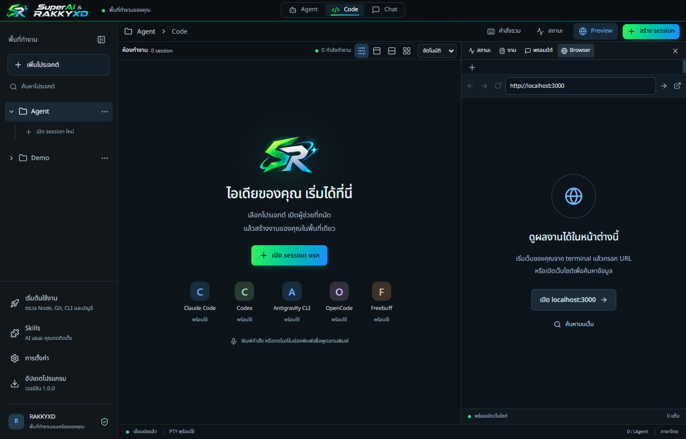
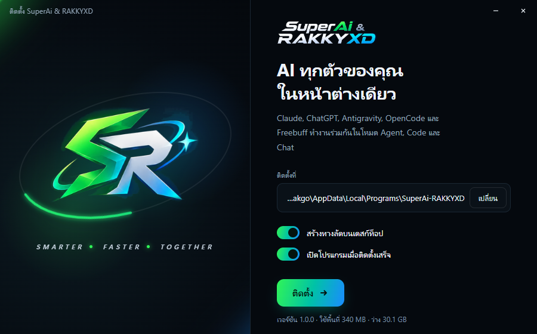
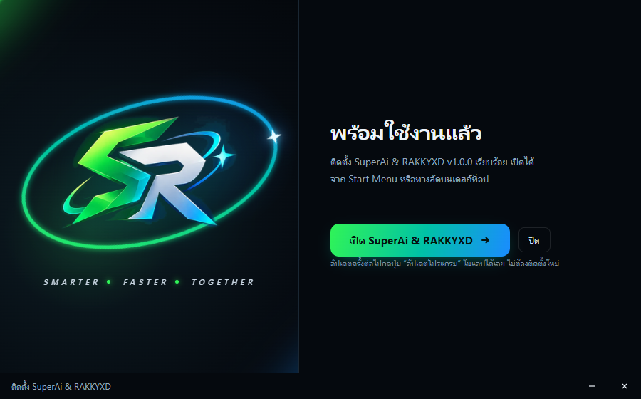
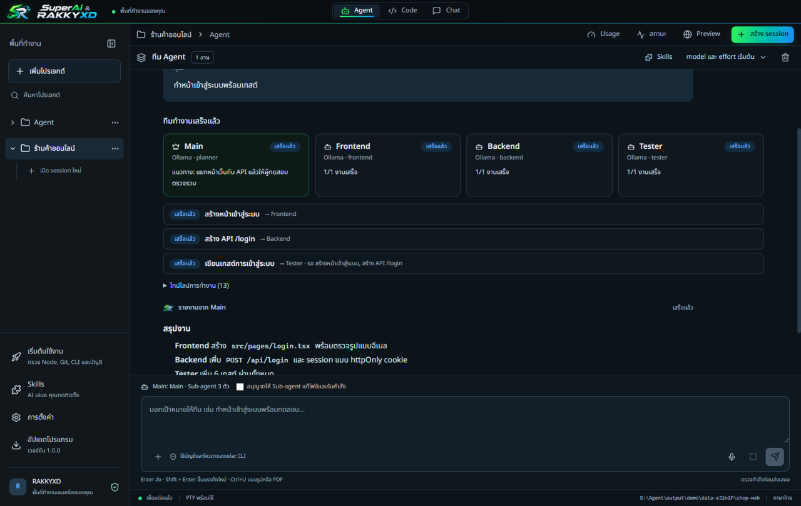
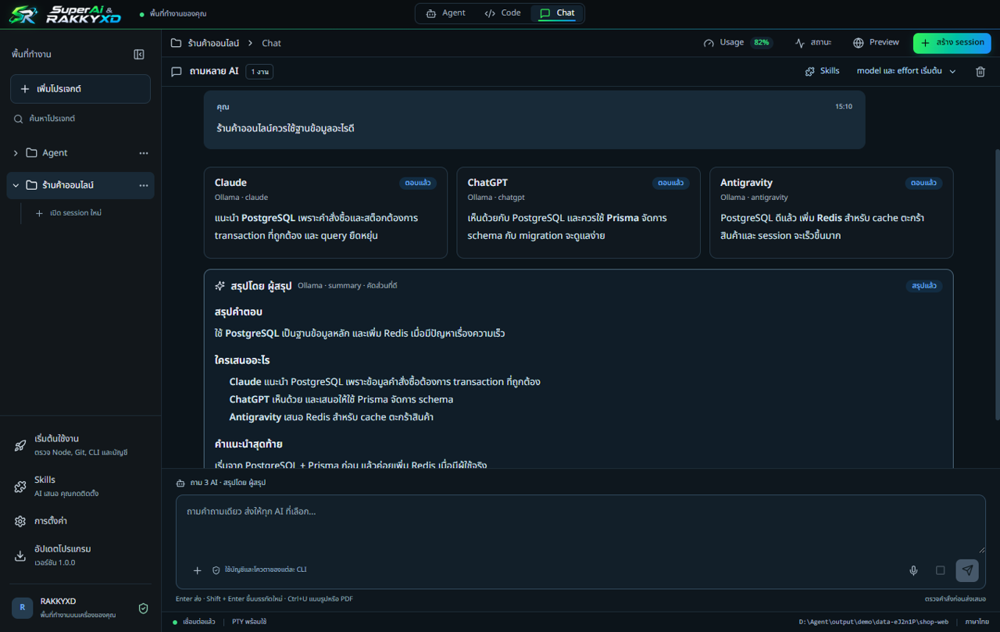
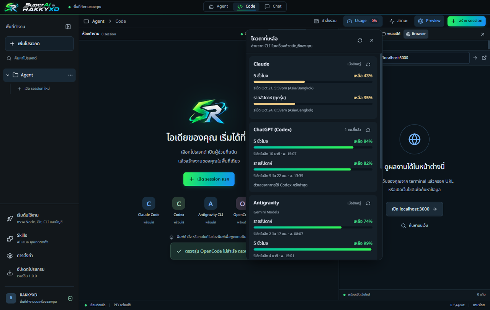

<p align="center">
  
</p>

<h1 align="center">SuperAi &amp; RAKKYXD</h1>

<p align="center">
  <b>AI ทุกตัวของคุณ ในหน้าต่างเดียว</b><br />
  Claude · ChatGPT (Codex) · Antigravity · OpenCode · Freebuff<br />
  Windows และ macOS · ภาษาไทย · ใช้บัญชี AI ของคุณเอง
</p>

<p align="center">
  <a href="https://github.com/rakgoorak/SuperAi-RAKKYXD-releases/releases/latest/download/SuperAi-RAKKYXD-Setup.exe"><b>⬇ ดาวน์โหลดสำหรับ Windows</b></a>
  &nbsp;·&nbsp;
  <a href="https://github.com/rakgoorak/SuperAi-RAKKYXD-releases/releases/latest/download/SuperAi-RAKKYXD-macos-arm64.dmg"><b>Mac (Apple Silicon)</b></a>
  &nbsp;·&nbsp;
  <a href="https://github.com/rakgoorak/SuperAi-RAKKYXD-releases/releases/latest/download/SuperAi-RAKKYXD-macos-x64.dmg"><b>Mac (Intel)</b></a>
</p>

<p align="center"></p>

ใช้ AI หลายตัวพร้อมกันแล้วต้องเปิดหลายโปรแกรมสลับไปมาใช่ไหม? SuperAi & RAKKYXD รวมทุกตัวไว้ในที่เดียว ให้ AI หลายตัวช่วยกันทำงาน เปิด CLI หลายแท็บ ถามคำถามเดียวกับทุกตัวแล้วสรุปให้ และดูได้ว่าโควตาของแต่ละเจ้าเหลือเท่าไร

---

## ดาวน์โหลด

| เครื่อง | ไฟล์ติดตั้ง | ขนาด |
| --- | --- | --- |
| Windows 10/11 (64-bit) | [SuperAi-RAKKYXD-Setup.exe](https://github.com/rakgoorak/SuperAi-RAKKYXD-releases/releases/latest/download/SuperAi-RAKKYXD-Setup.exe) | ≈90 MB |
| Mac Apple Silicon (M1 ขึ้นไป) | [SuperAi-RAKKYXD-macos-arm64.dmg](https://github.com/rakgoorak/SuperAi-RAKKYXD-releases/releases/latest/download/SuperAi-RAKKYXD-macos-arm64.dmg) | ≈110 MB |
| Mac Intel | [SuperAi-RAKKYXD-macos-x64.dmg](https://github.com/rakgoorak/SuperAi-RAKKYXD-releases/releases/latest/download/SuperAi-RAKKYXD-macos-x64.dmg) | ≈115 MB |

- ลิงก์ด้านบนเป็นเวอร์ชันล่าสุดเสมอ ไม่ต้องล็อกอิน GitHub
- หรือเปิด [หน้าดาวน์โหลด](https://rakgoorak.github.io/SuperAi-RAKKYXD-releases/) ที่เลือกไฟล์ให้ตรงกับเครื่องของคุณ
- ดูทุกเวอร์ชันและสิ่งที่เปลี่ยนในแต่ละรุ่นได้ที่ [Releases](https://github.com/rakgoorak/SuperAi-RAKKYXD-releases/releases)
- ไม่อยากติดตั้ง? ใช้ไฟล์ ZIP (portable) ในหน้า Releases: แตกทั้งโฟลเดอร์แล้วเปิดได้เลย

## ติดตั้ง

### Windows

1. ดับเบิลคลิก `SuperAi-RAKKYXD-Setup.exe` แล้วรอแตกไฟล์สักครู่
2. เลือกโฟลเดอร์ติดตั้ง ค่าเริ่มต้นไม่ต้องใช้สิทธิ์ผู้ดูแลระบบ
3. เลือกว่าจะ **สร้างทางลัดบนเดสก์ท็อป** และ **เปิดโปรแกรมเมื่อติดตั้งเสร็จ** หรือไม่ แล้วกด **ติดตั้ง**

<p align="center">
  
  
</p>

ตัวติดตั้งเพิ่มทางลัดใน Start Menu และรายการใน **Settings → Apps** ให้ด้วย

> **ถ้าขึ้น “Windows protected your PC”** ให้กด **More info → Run anyway** (โปรแกรมยังไม่มีใบรับรองผู้พัฒนาแบบเสียเงิน)

### macOS 11 ขึ้นไป

เปิดไฟล์ `.dmg` แล้วลาก **SuperAi & RAKKYXD** ไปที่ **Applications**

> **ถ้า macOS ไม่ยอมเปิดครั้งแรก** ไปที่ **System Settings → Privacy & Security** แล้วกด **Open Anyway**

### หลังติดตั้ง

เปิดโปรแกรมครั้งแรกจะมีหน้า **เริ่มต้นใช้งาน** ช่วยทีละขั้น: ติดตั้ง Node.js และ Git ให้, เลือกติดตั้ง CLI ของ AI ที่ต้องการ, เลือกโฟลเดอร์โปรเจกต์, เข้าสู่ระบบด้วยบัญชีของคุณ และเลือก model กับ effort เริ่มต้นของแต่ละเจ้า ไม่ต้องเตรียมอะไรมาก่อน

---

## ทำอะไรได้บ้าง

ทุกที่ที่เลือก AI เลือกได้ทั้ง **ผู้ให้บริการ**, **Model** และ **Effort** (ระดับความคิด)

### Agent: ทีม AI ช่วยกันทำงาน

เลือก Main 1 ตัว และ Sub-agent 1–6 ตัว Main วางแผนและแจกงาน งานที่ไม่ต้องรอกันทำพร้อมกัน แล้ว Main สรุปให้ว่าใครทำอะไร ไฟล์ไหนเปลี่ยน งานไหนยังไม่สำเร็จ เห็นทุกขั้นตอนบนหน้าจอ การให้ AI แก้ไฟล์เป็นสวิตช์ที่ปิดไว้ก่อนเสมอ

<p align="center"></p>

### Code: CLI หลายแท็บในหน้าต่างเดียว

เปิด Claude Code, Codex, Antigravity CLI, OpenCode, Freebuff และ Terminal ได้หลายแท็บ จัดคอลัมน์ ลากสลับ ขยายดูทีละช่อง และส่งคำสั่งเดียวไปหลายแท็บพร้อมกันได้

### Chat: ถามครั้งเดียว ได้ความเห็นจากทุก AI

พิมพ์คำถามครั้งเดียว ส่งให้ AI 1–5 ตัว แต่ละตัวตอบแยกกัน แล้วให้ผู้สรุปรวมผล หรือคัดเฉพาะส่วนที่ดี พร้อมบอกว่าตัวไหนแนะนำอะไร

<p align="center"></p>

### Usage: ดูโควตาที่เหลือ

ปุ่ม **Usage** มุมขวาบนบอกว่าแต่ละเจ้าเหลือโควตาเท่าไร: Claude และ ChatGPT แสดงโควตา 5 ชั่วโมงกับรายสัปดาห์ Antigravity แยกตามกลุ่มรุ่น และ OpenCode แสดงการใช้งาน 7 วัน พร้อมเวลารีเซ็ตและสีบอกระดับ

<p align="center"></p>

### และอื่นๆ

- **Skills:** AI เสนอ skill ที่จำเป็นต่อโปรเจกต์จากแหล่งทางการของ Anthropic และ OpenAI ติดตั้งเมื่อคุณกดยืนยันเท่านั้น
- **พูดเพื่อพิมพ์:** กดค้างปุ่มไมค์แล้วพูดภาษาไทย แปลงเสียงบนเครื่อง เสียงไม่ออกไปไหน
- **แนบรูปและ PDF:** ลากมาวาง, Ctrl+V หรือปุ่ม +
- **Browser Preview:** เปิดเว็บที่กำลังทำ (`localhost`) ข้างงานของคุณ

---

## อัปเดต

ไม่ต้องดาวน์โหลดใหม่ทุกครั้ง ตั้งแต่ v1.0.3 โปรแกรมตรวจเวอร์ชันใหม่ให้เองตอนเปิดและทุก 30 นาที แล้วแจ้งทันที

- **อัปเดตทั่วไป:** มีการ์ดขึ้นมุมล่างขวา กด **อัปเดตตอนนี้** หรือ **ไว้ทีหลัง** ก็ได้ ไม่อัปเดตก็ยังใช้งานได้ตามปกติ
- **อัปเดตที่จำเป็น:** ต้องอัปเดตก่อนใช้งานต่อ โปรแกรมจะติดตั้งให้เอง
- **งานไม่หาย:** โปรแกรมรอให้ AI ที่กำลังตอบทำงานเสร็จก่อนจึงติดตั้ง แล้วเปิดแท็บเดิมกลับมาคุยต่อจากบทสนทนาเดิม ข้อความที่พิมพ์ค้างไว้ โปรเจกต์ และการตั้งค่าอยู่ครบ
- ไฟล์ถูกตรวจ SHA-256 ก่อนติดตั้งทุกครั้ง

ถ้าใช้ v1.0.2 หรือเก่ากว่า ให้กดปุ่ม **อัปเดตโปรแกรม** ที่แถบซ้ายเองหนึ่งครั้ง

## ถอนการติดตั้ง

- **Windows:** Settings → Apps → SuperAi & RAKKYXD → Uninstall
- **Mac:** ลากแอปจาก Applications ไปที่ถังขยะ

โปรเจกต์ ประวัติ และการตั้งค่าของคุณจะยังอยู่ (เก็บใน `~/.opencode-multi`)

## ความเป็นส่วนตัว

โปรแกรมทำงานบนเครื่องคุณทั้งหมด ไม่มีเซิร์ฟเวอร์ของตัวเอง และคุยกับ AI ผ่าน CLI ที่คุณล็อกอินด้วยบัญชีของคุณเอง โปรแกรมไม่เก็บรหัสผ่าน ค่าใช้จ่ายและโควตาเป็นไปตามแพ็กเกจของผู้ให้บริการแต่ละเจ้า

## แก้ปัญหาที่พบบ่อย

| อาการ | วิธีแก้ |
| --- | --- |
| Windows ขึ้น “Windows protected your PC” | กด **More info → Run anyway** |
| Mac ขึ้นว่าเปิดแอปไม่ได้ | System Settings → Privacy & Security → **Open Anyway** |
| AI ตอบว่ารุ่นนี้ใช้กับบัญชีไม่ได้ | เลือก model อื่น หรือเว้นว่างเพื่อใช้ค่าเริ่มต้นของ CLI |
| Usage ของ ChatGPT ไม่ขึ้น | ใช้ Codex สักครั้งแล้วกดรีเฟรชในหน้าต่าง Usage |
| ปุ่มอัปเดตบอกว่าไม่มีสิทธิ์เขียนโฟลเดอร์ | ติดตั้งใหม่ด้วย Setup.exe ในโฟลเดอร์ค่าเริ่มต้น |

## ตรวจความถูกต้องของไฟล์ (ไม่บังคับ)

ทุกไฟล์มี `.sha256` คู่กัน ตรวจได้ด้วย

```powershell
# Windows (PowerShell)
Get-FileHash .\SuperAi-RAKKYXD-Setup.exe -Algorithm SHA256
```

```bash
# macOS
shasum -a 256 SuperAi-RAKKYXD-macos-arm64.dmg
```

แล้วเทียบกับตัวเลขในไฟล์ `.sha256` ของรุ่นนั้น

## แจ้งปัญหาหรือเสนอความสามารถ

เปิด [แจ้งปัญหา / เสนอความสามารถ](https://github.com/rakgoorak/SuperAi-RAKKYXD-releases/issues/new/choose) แล้วเลือกแบบฟอร์ม กรอกเป็นภาษาไทยได้เลย อย่าใส่รหัสผ่าน API key หรือข้อมูลส่วนตัว เพราะทุกคนเห็นได้
