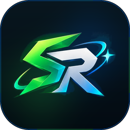
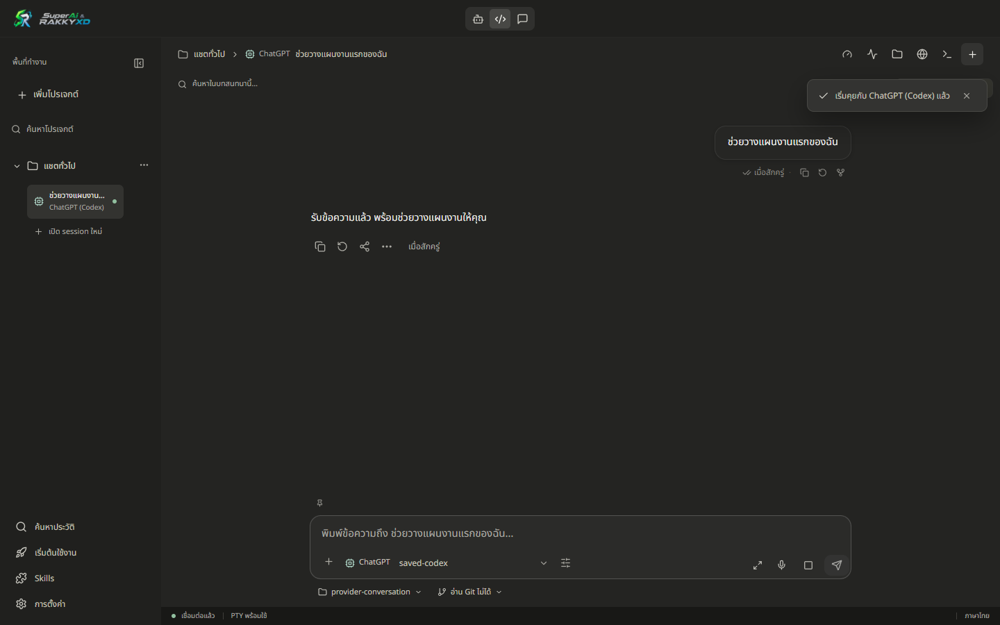
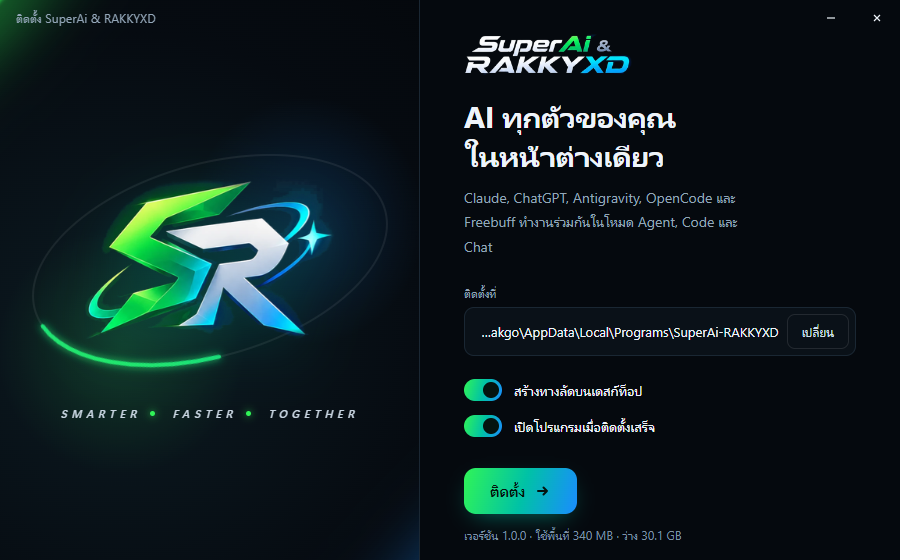
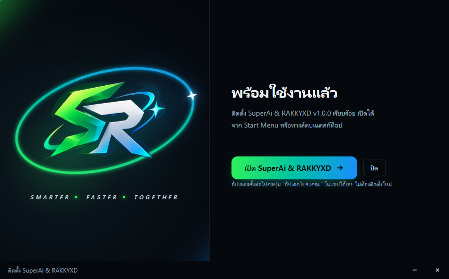
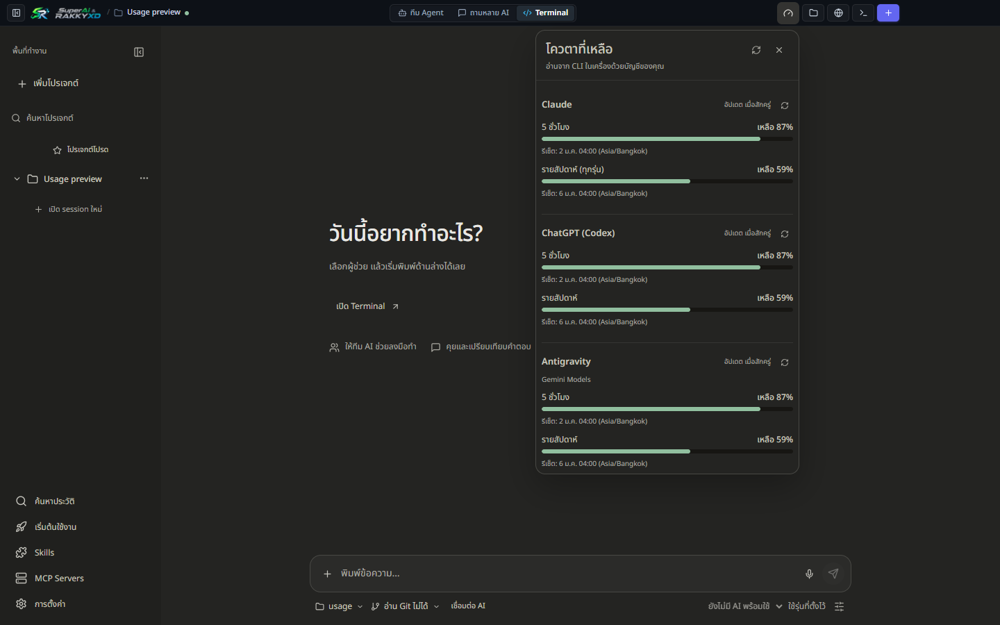

  

<h1 align="center">SuperAi &amp; RAKKYXD</h1>

  <b>AI ทุกตัวของคุณ ในหน้าต่างเดียว — ดีไซน์ใหม่ Minimal เรียบหรู โฟกัสกับงาน</b> 
  Claude · ChatGPT (Codex) · Antigravity · OpenCode · Freebuff 
  Windows และ macOS · ภาษาไทย · รันบนเครื่องคุณ 100% · ใช้บัญชี AI ของคุณเอง

  <a href="https://github.com/rakgoorak/SuperAi-RAKKYXD-releases/releases/latest/download/SuperAi-RAKKYXD-Setup.exe"><b>⬇ ดาวน์โหลดสำหรับ Windows</b></a>
  &nbsp;·&nbsp;
  <a href="https://github.com/rakgoorak/SuperAi-RAKKYXD-releases/releases/latest/download/SuperAi-RAKKYXD-macos-arm64.dmg"><b>Mac (Apple Silicon)</b></a>
  &nbsp;·&nbsp;
  <a href="https://github.com/rakgoorak/SuperAi-RAKKYXD-releases/releases/latest/download/SuperAi-RAKKYXD-macos-x64.dmg"><b>Mac (Intel)</b></a>

  

ใช้ AI หลายตัวพร้อมกันแล้วต้องเปิดหลายโปรแกรมสลับไปมาใช่ไหม? **SuperAi & RAKKYXD** รวมทุกตัวไว้ในที่เดียว ให้ AI หลายตัวช่วยกันทำงาน เปิด CLI หลายแท็บ ถามคำถามเดียวกับทุกตัวแล้วสรุปให้ สลับ Git Branch / Worktrees คู่ขนาน และดูได้ว่าโควตาของแต่ละเจ้าเหลือเท่าไร

---

## ดาวน์โหลด

| เครื่อง | ไฟล์ติดตั้ง | ขนาด | รูปแบบ |
| :--- | :--- | :--- | :--- |
| **Windows 10/11 (64-bit)** | [SuperAi-RAKKYXD-Setup.exe](https://github.com/rakgoorak/SuperAi-RAKKYXD-releases/releases/latest/download/SuperAi-RAKKYXD-Setup.exe) | ≈90 MB | ตัวติดตั้งอัตโนมัติ (NSIS) |
| **Mac Apple Silicon (M1 ขึ้นไป)** | [SuperAi-RAKKYXD-macos-arm64.dmg](https://github.com/rakgoorak/SuperAi-RAKKYXD-releases/releases/latest/download/SuperAi-RAKKYXD-macos-arm64.dmg) | ≈110 MB | Drag & Drop DMG |
| **Mac Intel** | [SuperAi-RAKKYXD-macos-x64.dmg](https://github.com/rakgoorak/SuperAi-RAKKYXD-releases/releases/latest/download/SuperAi-RAKKYXD-macos-x64.dmg) | ≈115 MB | Drag & Drop DMG |

- ลิงก์ด้านบนเป็นเวอร์ชันล่าสุดเสมอ ไม่ต้องล็อกอิน GitHub
- หรือเปิด [หน้าเว็บไซต์ดาวน์โหลด](https://rakgoorak.github.io/SuperAi-RAKKYXD-releases/) ที่ตรวจจับระบบปฏิบัติการและแนะนำไฟล์ให้ตรงกับเครื่องของคุณ
- ดูทุกเวอร์ชันและสิ่งที่เปลี่ยนในแต่ละรุ่นได้ที่ [Releases](https://github.com/rakgoorak/SuperAi-RAKKYXD-releases/releases)
- ไม่อยากติดตั้ง? ใช้ไฟล์ ZIP (Portable) ในหน้า Releases: แตกโฟลเดอร์แล้วเปิดใช้งานได้ทันที

---

## ติดตั้ง

### Windows
1. ดับเบิลคลิก `SuperAi-RAKKYXD-Setup.exe` แล้วรอสักครู่
2. เลือกโฟลเดอร์ติดตั้ง ค่าเริ่มต้น `%LOCALAPPDATA%\Programs\SuperAi-RAKKYXD` ไม่ต้องใช้สิทธิ์ Admin
3. เลือกว่าจะสร้างทางลัดบนเดสก์ท็อป และเปิดโปรแกรมเมื่อติดตั้งเสร็จหรือไม่ แล้วกด **ติดตั้ง**

  
  

ตัวติดตั้งเพิ่มทางลัดใน Start Menu และรายการใน **Settings → Apps** ให้เรียบร้อย

> **ถ้าขึ้น “Windows protected your PC”** ให้กด **More info → Run anyway** (เนื่องจากโปรแกรมยังไม่มีใบรับรองดิจิทัลแบบชำระเงิน)

### macOS 11 ขึ้นไป
เปิดไฟล์ `.dmg` แล้วลาก **SuperAi & RAKKYXD** ไปที่โฟลเดอร์ **Applications**

> **ถ้า macOS ไม่ยอมเปิดครั้งแรก** ไปที่ **System Settings → Privacy & Security** แล้วกด **Open Anyway**

---

## ไฮไลต์ฟีเจอร์ใหม่ & Minimal UI

- **ดีไซน์ใหม่ Warm Charcoal Minimal:** เรียบหรู สะอาดตา สบายตา ลดความรกรุงรัง ให้ความสำคัญกับโค้ดและงานตรงหน้า
- **สวิตช์ 3 โหมดแบบ Compact 3-Icon Switch:** สลับโหมด Agent, Code และ Chat ได้ในคลิกเดียว พร้อมคำอธิบายฟังก์ชัน
- **Quick Provider Chat & Safe Mode:** เริ่มพิมพ์คุยกับ AI ได้ทันทีตั้งแต่เปิดแอป ไม่ต้องตั้งค่าโปรเจกต์ก่อน พร้อมโหมด Safe Read-only ป้องกันไฟล์ในเครื่องถูกแก้ไขโดยไม่ได้ตั้งใจ
- **Composer Options รวมศูนย์:** ปรับระดับความคิด (Effort), สิทธิ์การเขียนไฟล์ และรายละเอียดบัญชี AI ได้ในปุ่มเดียว พร้อมปุ่มลัด `Escape` เพื่อปิด
- **Unified History & Full-Text Search:** รวมประวัติการสนทนาทุกเซสชันของทุก AI ค้นหาข้อความได้ทั้งโปรเจกต์ และกรองตามผู้ให้บริการได้
- **ซ่อนเซสชันโดยไม่ต้องลบ (`EyeOff`):** พับเก็บเซสชันที่ไม่ใช้งานออกจากหน้าจอหลักเพื่อจัดระเบียบพื้นที่ โดยประวัติและโปรเซสยังคงทำงานต่อ 100%
- **Git Worktrees & Branch Switcher:** สลับ branch ได้อย่างปลอดภัย และสร้าง worktree พัฒนาหลายฟีเจอร์พร้อมกันโดยไฟล์ไม่ชนกัน พร้อมแถบ Smart Merge ช่วยรวมโค้ดกลับเข้า main
- **Ctrl + Click เปิด URL ทันที:** กด Ctrl+Click (หรือ Cmd+Click บน Mac) บนลิงก์ในช่องพิมพ์หรือข้อความแชท เพื่อเปิดเว็บเบราว์เซอร์ภายนอกทันทีเหมือนใน Claude App
- **Interactive Artifacts:** พรีวิวโค้ดสด (HTML/SVG/Tailwind/Mermaid) และทดสอบโค้ด React/JSX/TSX แบบอินเทอร์แอคทีฟ
- **Local Whisper Voice Typing:** พูดภาษาไทยเพื่อพิมพ์ข้อความ แปลงเสียงบนเครื่อง 100% เสียงไม่ออกนอกเครื่อง
- **Usage Tracker:** ตรวจสอบโควตาคงเหลือของ Claude, Codex, Antigravity แบบเรียลไทม์

  

---

## อัปเดตและถอนการติดตั้ง

- **อัปเดตอัตโนมัติ:** โปรแกรมตรวจเวอร์ชันใหม่ให้เองตอนเปิดและทุก 30 นาที หากมีเวอร์ชันใหม่จะแจ้งเตือนที่มุมล่างขวา สามารถกดอัปเดตได้ทันทีโดยไม่ต้องดาวน์โหลดใหม่เอง
- **งานไม่หาย:** เมื่ออัปเดต โปรแกรมจะรอให้ AI ตอบเสร็จก่อน แล้วเปิดแท็บและประวัติเดิมกลับมาคุยต่อได้อย่างต่อเนื่อง
- **ถอนการติดตั้ง (Windows):** ไปที่ **Settings → Apps → Installed apps → SuperAi & RAKKYXD → Uninstall**
- **ถอนการติดตั้ง (macOS):** ลากแอปจากโฟลเดอร์ Applications ลงถังขยะ

---

## ความเป็นส่วนตัว

โปรแกรมทำงานบนเครื่องของคุณทั้งหมด (Local-First) ไม่มีเซิร์ฟเวอร์กลางดักเก็บข้อมูล การสนทนาและการสั่งงานทั้งหมดส่งตรงไปยังผู้ให้บริการ AI ผ่าน CLI หรือ API Key ที่คุณล็อกอินด้วยตัวเอง

---

## แจ้งปัญหาหรือเสนอแนะความสามารถ

หากพบปัญหาหรือมีไอเดียฟีเจอร์ใหม่ สามารถเปิดแจ้งได้ที่ [Issues](https://github.com/rakgoorak/SuperAi-RAKKYXD-releases/issues/new/choose)
