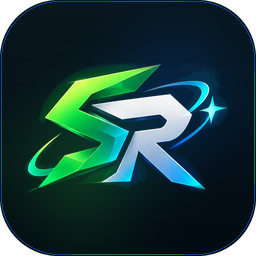
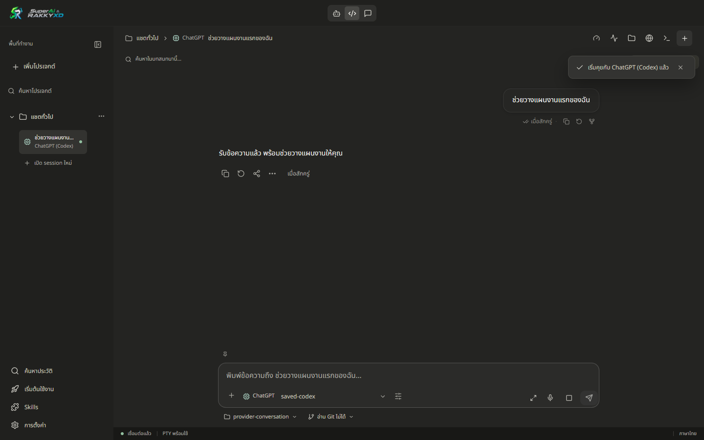
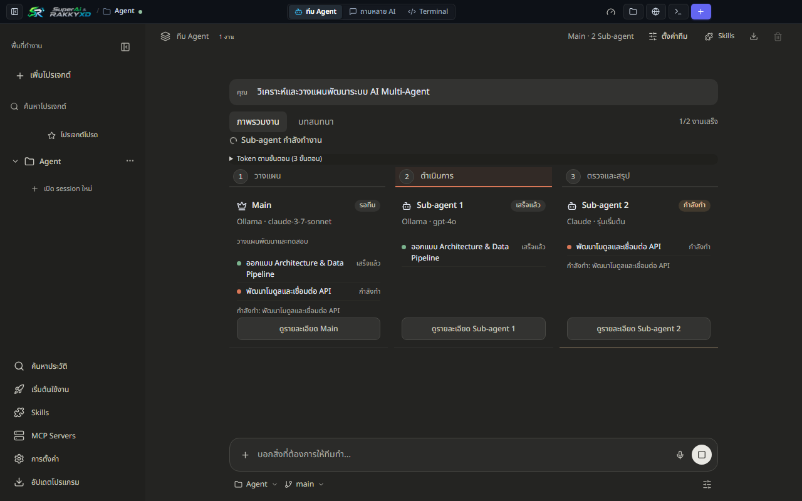
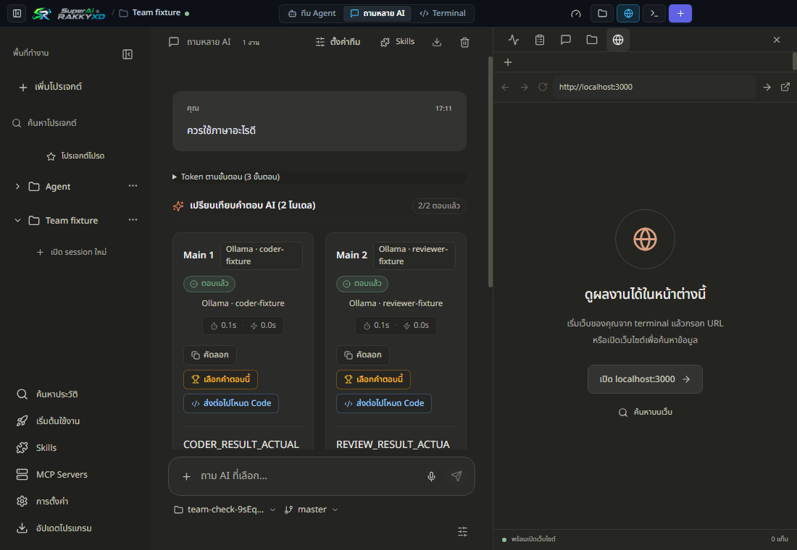
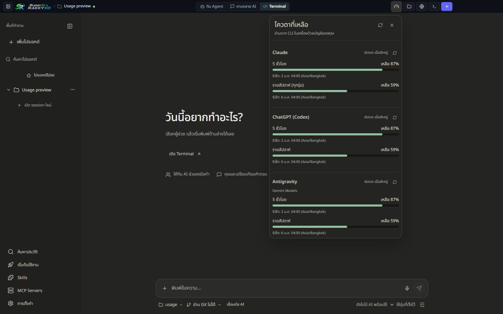

  

<h1 align="center">SuperAi &amp; RAKKYXD Releases</h1>

  
  
  

  <a href="README.md">🇹🇭 ภาษาไทย</a> &nbsp;|&nbsp; <b>🇬🇧 English</b> &nbsp;|&nbsp; 🇯🇵 日本語 &nbsp;|&nbsp; 🇨🇳 简体中文

  <b>All your AI coding assistants in a single, minimal, privacy-first desktop workspace (v1.0.36).</b> 
  Claude Code · ChatGPT (Codex) · Antigravity · OpenCode · Freebuff · Ollama 
  Windows & macOS · Multi-language (EN / TH / JA / ZH) · 100% Local-first · Bring Your Own Keys

  <a href="https://github.com/rakgoorak/SuperAi-RAKKYXD-releases/releases/latest/download/SuperAi-RAKKYXD-Setup.exe"><b>⬇ Download for Windows (Setup.exe)</b></a>
  &nbsp;·&nbsp;
  <a href="https://github.com/rakgoorak/SuperAi-RAKKYXD-releases/releases/latest/download/SuperAi-RAKKYXD-macos-arm64.dmg"><b>Mac (Apple Silicon)</b></a>
  &nbsp;·&nbsp;
  <a href="https://github.com/rakgoorak/SuperAi-RAKKYXD-releases/releases/latest/download/SuperAi-RAKKYXD-macos-x64.dmg"><b>Mac (Intel)</b></a>

  

---

## Downloads

| Platform | Installer File | Size | Format |
| :--- | :--- | :--- | :--- |
| **Windows 10 / 11 (64-bit)** | [SuperAi-RAKKYXD-Setup.exe](https://github.com/rakgoorak/SuperAi-RAKKYXD-releases/releases/latest/download/SuperAi-RAKKYXD-Setup.exe) | ≈91 MB | Auto-installer (NSIS) |
| **macOS Apple Silicon (M1–M4)** | [SuperAi-RAKKYXD-macos-arm64.dmg](https://github.com/rakgoorak/SuperAi-RAKKYXD-releases/releases/latest/download/SuperAi-RAKKYXD-macos-arm64.dmg) | ≈110 MB | Drag & Drop DMG |
| **macOS Intel (x64)** | [SuperAi-RAKKYXD-macos-x64.dmg](https://github.com/rakgoorak/SuperAi-RAKKYXD-releases/releases/latest/download/SuperAi-RAKKYXD-macos-x64.dmg) | ≈115 MB | Drag & Drop DMG |

- The download links above always point to the newest stable release (**v1.0.36**). No GitHub login required.
- Or visit our official [Download Website](https://rakgoorak.github.io/SuperAi-RAKKYXD-releases/) which automatically detects your operating system and recommends the correct file.
- 📊 Track live download statistics and community adoption anytime at [GitHub Releases Stats (Grev)](https://hanadigital.github.io/grev/?user=rakgoorak&repo=SuperAi-RAKKYXD-releases).
- Prefer a portable build? Download the standalone ZIP package from [Releases](https://github.com/rakgoorak/SuperAi-RAKKYXD-releases/releases): extract and run immediately without installation.

---

## Real Interface Showcase

   
  <em>🤖 Agent Mode: Autonomous multi-agent coordination with parallel sub-agents and automated task breakdown</em>

   
  <em>💬 Chat Mode: Ask once, get responses from multiple models simultaneously, with instant synthesis</em>

   
  <em>📊 Quota Tracker: Monitor your 5-hour rolling windows and weekly token limits in real time</em>

---

## What's New in v1.0.36
- **🌐 Full Multi-Language Support**: Switch seamlessly between English, Thai, Japanese, and Simplified Chinese inside Settings.
- **🛡️ Live Community Download Counters**: Live GitHub release download metrics embedded in the app and website.
- **⚡ Performance & UI Polish**: Even smoother animations and optimized layout across all three modes (Agent, Code, Chat).
- **🔒 Security & Privacy Audit**: Local-first sandboxing with strict safety checks for shell commands and file writing.

---

## Source Code & Contributions
The source code is hosted on [GitHub: rakgoorak/SuperAi-RAKKYXD](https://github.com/rakgoorak/SuperAi-RAKKYXD).  
Licensed under the [MIT License](https://github.com/rakgoorak/SuperAi-RAKKYXD/blob/main/LICENSE).
